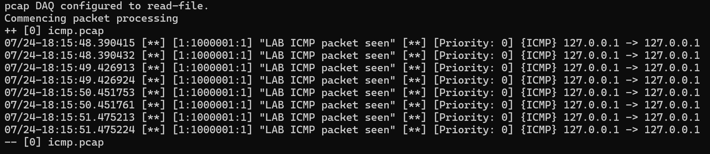
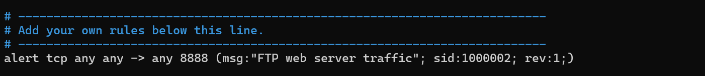
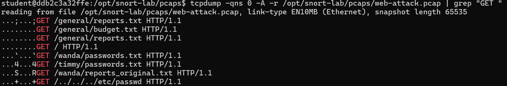
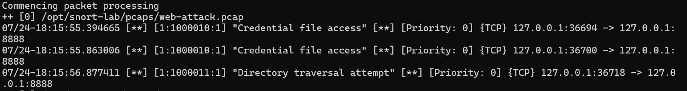

# Snort Network Intrusion Detection

## Overview

In this project, I used Snort 3 as a Network Intrusion Detection System (NIDS) to analyze captured network traffic and detect suspicious activity.

I worked with PCAP files, created custom Snort rules, and used rule conditions such as `content` and `flow` to identify credential file access and directory traversal attempts. I also learned how more specific detection rules can reduce unnecessary alerts and make suspicious activity easier to identify.

## Tools Used

- Snort 3
- Docker
- tcpdump
- PCAP files
- Linux command line

## Investigation Process

### 1. Set Up the Snort Environment

I ran the Snort lab inside a Docker container and confirmed that Snort 3 was installed and ready to analyze network traffic.


### 2. Analyze ICMP Traffic

I used Snort to analyze an ICMP packet capture.

```bash
snort -c /usr/local/etc/snort/snort.lua -r icmp.pcap -A alert_fast
```

Snort analyzed eight ICMP packets and generated eight alerts.



### 3. Create a Custom Snort Rule

I created my first custom rule to detect TCP traffic going to the web service on port `8888`.

```text
alert tcp any any -> any 8888 (msg:"FTP web server traffic"; sid:1000002; rev:1;)
```



This rule successfully generated alerts, but because it matched all TCP traffic going to port `8888`, it was too broad for identifying specific malicious activity.

### 4. Inspect HTTP Requests

I examined the HTTP requests inside the web attack PCAP using `tcpdump`.

```bash
tcpdump -qns 0 -A -r /opt/snort-lab/pcaps/web-attack.pcap | grep "GET "
```

This revealed normal requests as well as suspicious requests involving password files, a hidden report, and directory traversal.



### 5. Detect Specific Attack Activity

I created more specific Snort rules using `flow` and `content` conditions.

Credential file access:

```text
alert tcp any any -> any 8888 (msg:"Credential file access"; flow:to_server,established; content:"passwords.txt"; sid:1000010; rev:1;)
```

Directory traversal:

```text
alert tcp any any -> any 8888 (msg:"Directory traversal attempt"; flow:to_server,established; content:"../"; sid:1000011; rev:1;)
```

Running Snort against the PCAP generated three targeted alerts:

- Two credential file access alerts
- One directory traversal alert



## Findings

The analysis identified suspicious requests involving:

- `/wanda/passwords.txt`
- `/timmy/passwords.txt`
- `/../../../etc/passwd`

The credential detection rule correctly identified both attempts to access password files, while the directory traversal rule detected the attempt to access `/etc/passwd`.

## What I Learned

This project helped me understand how signature-based intrusion detection systems analyze network traffic and how custom detection rules can be used to identify specific attack behavior.

I also learned that writing a rule that detects traffic is only part of the process. Detection rules need to be specific enough to catch malicious activity without generating too many unnecessary alerts.

## Skills Practiced

- Network intrusion detection
- Snort rule creation
- PCAP analysis
- Network traffic analysis
- Signature-based detection
- HTTP traffic inspection
- Detection rule tuning
- False-positive reduction
- Incident investigation
