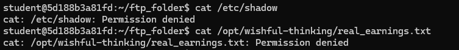
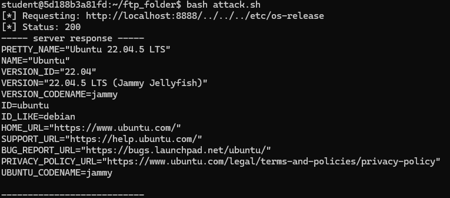
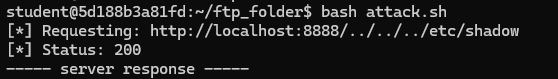
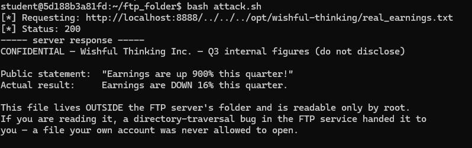
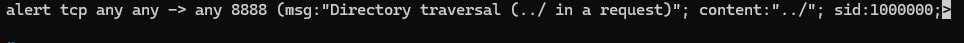
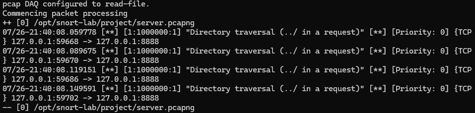
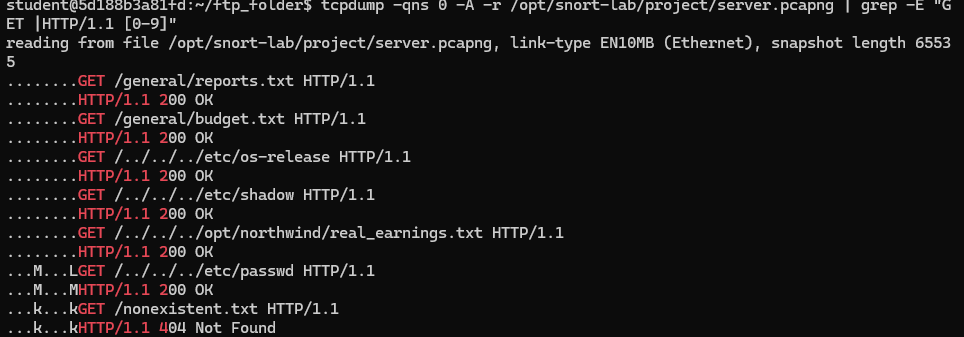

# Snort Directory Traversal Investigation

## Overview

In this project, I investigated a directory-traversal vulnerability in a vulnerable file service. I first tested the vulnerability from the attacker’s perspective to determine whether files outside the intended directory could be accessed. I then switched to the defensive side, wrote a Snort detection rule, analyzed captured network traffic, and determined what files the attacker was able to reach.

This project gave me hands-on experience with both offensive testing and defensive network investigation.

## Tools Used

- Snort 3
- Linux
- tcpdump
- PCAP/PCAPNG analysis
- Bash
- HTTP traffic analysis

## Investigation Process

### 1. Confirm Normal Access Restrictions

Before testing the vulnerability, I verified that my normal user account could not directly access sensitive files such as `/etc/shadow` and the confidential earnings file.

This helped establish that any later access to those files was occurring through the vulnerable service rather than through my own account permissions.

### 2. Test the Directory Traversal Vulnerability

The service was intended to return files from its designated FTP directory, but it did not properly validate requested file paths.

By using `../` sequences in the request path, I was able to move outside the intended directory and access other parts of the filesystem.

I first retrieved the system's OS information from `/etc/os-release`.

I was also able to reach `/etc/shadow`, even though my normal user account did not have permission to read it.

### 3. Access a Confidential File

I used the same vulnerability to access the confidential earnings file located outside the service's normal directory.

This demonstrated the impact of the vulnerability because the service was able to read information that my own account was not authorized to access.

### 4. Create a Snort Detection Rule

After confirming the vulnerability, I switched to the defensive side of the investigation.

I created a Snort rule to detect traffic containing the `../` sequence being sent to the vulnerable service.

### 5. Detect the Attack

I ran Snort against a captured attack in `server.pcapng`.

The rule successfully detected the four directory-traversal requests contained in the network capture.

### 6. Scope the Breach

Detection confirmed that directory traversal had occurred, but I also needed to determine what the attacker actually accessed.

I used `tcpdump` to inspect the HTTP requests and response statuses in the packet capture. By correlating the requests with successful responses, I identified the files that were served and separated normal requests from files reached through directory traversal.

## Findings

The investigation confirmed that the vulnerable service allowed attackers to escape its intended directory using directory-traversal sequences.

Because the service was running with elevated privileges, the vulnerability allowed access to sensitive files that the requesting user could not read directly.

The network capture contained six successfully served requests, including four requests that used directory traversal to reach files outside the intended FTP directory.

## Remediation

The service should check and validate every requested file path before accessing it, making sure the final path stays within `/home/student/ftp_folder`. This would prevent attackers from using `../` to access files outside the intended directory.

As an added layer of protection, the service should also run with a dedicated, limited user account instead of root. That way, even if a similar vulnerability happens again, the service would not have permission to access sensitive files across the system.

## Skills Demonstrated

- Snort IDS rule creation
- Network intrusion detection
- Directory traversal analysis
- Packet capture analysis
- tcpdump
- Linux filesystem permissions
- Vulnerability exploitation in a controlled lab
- Incident investigation
- Breach scoping
- Defense-in-depth
- Security remediation

## What I Learned

This project showed me why detecting an attack is only part of an investigation. After identifying the directory-traversal traffic, I still had to analyze the network capture to determine what the attacker successfully accessed.

It also demonstrated how service permissions can affect the impact of a vulnerability. Running the vulnerable service with root privileges turned a path-validation problem into access to sensitive files across the system.
